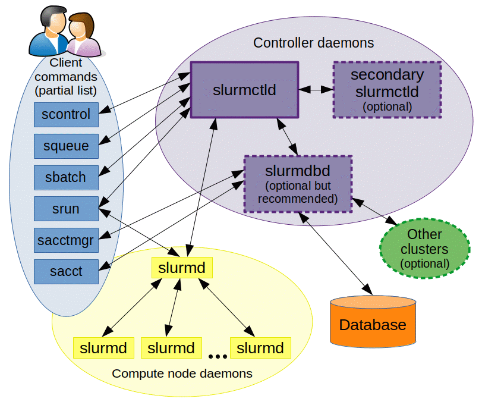

# Amarel Tutorial

## 1 About

One of the training and inference infrastructure options we will use in this class for larger workloads is Rutgers' own [Amarel](https://it.rutgers.edu/research-computing/amarel/) computing cluster, created and managed by the Office of Advanced Research Computing (OARC). As distinct from the *local development* options we have encountered so far, Amarel provides a shared *cluster* or group of networked computers that you can access to perform training runs using more GPUs than would be practical with your local setup. (Unless you have a *very* high-end home setup!) While research groups can purchase their own dedicated Amarel resources, a general access category is provided free to Rutgers students and faculty.

You can learn more about Amarel in the [user guide](https://user-guide-f4258a.gitlab.io/). This tutorial loosely follows the user guide and other relevant resources to briefly introduce Amarel, walk through requesting an account, accessing the cluster, confirming you can configure a Python development environment that mirrors that which we have been using in class, and run Hello World training examples. As we move toward training larger networks with more parameters on larger datasets, which will demand more storage, memory, and compute (operations per second) than is practical on our laptops, Amarel will be one of the options available to us to *scale* our systems.

The Amarel [webpage](https://it.rutgers.edu/research-computing/amarel/#about-amarel) introduces Amarel as follows.

*Amarel is a shared, community‑owned advanced computing environment available to Rutgers researchers and students whose projects require computational resources. It combines a flexible design that supports a wide range of research needs with standardized tools and policies, making it easier to use, manage, and troubleshoot while delivering a smooth, consistent user experience.*

*Amarel operates under a ‘condo model,’ offering free, first‑come, first‑served access to all Rutgers researchers, including students, staff, and faculty. In this model, research groups can purchase their own compute nodes and storage, gaining priority access to those resources and the ability to preempt general‑access jobs when needed. The university provides the remaining infrastructure—data center facilities, power and cooling, networking, hardware support, and system administration—at no additional cost.*

An overview of the resources Amarel provides is given in the user manual [here](https://user-guide-f4258a.gitlab.io/systems/).

### 1.1 Maintenance Schedule

Amarel follows a tentative maintenance schedule with maintenance outages spanning up to 2 days each month, starting on the 3rd Tuesday of the month. In some cases the maintenance period ends early, but in general each maintenance period is expected to begin at about 08:00 ET on the first day and end by about 23:59 ET on the 2nd day. You can get more information about Amarel's current status and maintenance periods [here](https://it.rutgers.edu/research-computing/amarel-system-status/).

### 1.2 Quick Resources

* **User Guide**: [https://user-guide-f4258a.gitlab.io/](https://user-guide-f4258a.gitlab.io/)
* **Website**: [https://it.rutgers.edu/research-computing/amarel/](https://it.rutgers.edu/research-computing/amarel/)
* **FAQ**: [https://it.rutgers.edu/research-computing/research-computing-faqs/#amarel-faq](https://it.rutgers.edu/research-computing/research-computing-faqs/#amarel-faq)
* **Amarel introductory video**: [https://www.youtube.com/watch?v=GECyL_5NcAk&t=1s](https://www.youtube.com/watch?v=GECyL_5NcAk&t=1s)
* **Account Request**: [https://it.rutgers.edu/research-computing/amarel-cluster-access-request/](https://it.rutgers.edu/research-computing/amarel-cluster-access-request/)
* **System Status**: [https://it.rutgers.edu/research-computing/amarel-system-status/](https://it.rutgers.edu/research-computing/amarel-system-status/)

## 2 Cluster Basics

Before proceeding, it is helpful to review basic cluster computing terms and concepts. A computing cluster is a collection of interconnected computers, called *nodes*, that work together to provide computational resources. Clusters allow users to run workloads that require more processing power, memory, or storage than is available on a typical personal computer.

### 2.1 Login Nodes vs. Compute Nodes

**Login nodes** are used to access the cluster, manage files, install software, and submit computational jobs. They are not intended for computationally intensive tasks.

**Compute nodes** are dedicated to executing computational jobs. Users typically access these resources through a job scheduler rather than connecting to them directly.

### 2.2 Shared Resource Management

Computing clusters are shared by many users, who must share limited computational resources. A **job scheduler**, such as Slurm (the scheduler used by Amarel), manages these resources by allocating compute nodes, CPU cores, memory, and GPUs to submitted jobs. Jobs may be placed in a queue until the requested resources become available. (Yes this means you might need to go grab a coffee while you wait for your job to start!)

### 2.3 Partitions

A **partition** is a logical grouping of compute nodes with particular hardware configurations or scheduling policies. For example, Amarel provides a `main` partition for general computing and a `gpu` partition for GPU-accelerated workloads. Users select an appropriate partition when submitting jobs, depending on their computational requirements.

### 2.4 Cores and Hyperthreads

A **CPU core** is a physical processing unit inside a CPU that independently executes program instructions. Modern CPUs contain multiple cores, allowing multiple tasks to execute in parallel. **Hyper-threading** is an Intel technology that allows a single physical CPU core to execute two hardware threads, appearing to the operating system as two *logical CPUs*. AMD provides similar functionality through *simultaneous multithreading* (SMT). Logical CPUs share the resources of their underlying physical core, so two hyperthreads do not generally provide twice the performance of a single physical core.

## 3 Setup

These steps need to be performed before accessing Amarel for the first time.

### 3.1 Request an Account

Follow the directions [here](https://it.rutgers.edu/research-computing/amarel-cluster-access-request/) to request an account. You may need to enter your Rutgers credentials. Note it will usually take approximately 72 hours for accounts to be provisioned, and may take longer. Be sure to request an account early to provide time for provisioning.

You will get an email when your account has been set up by the Amarel team. Your account name will look something like `<netID>@amarel.rutgers.edu`.

Read the acceptable use policy [here](https://user-guide-f4258a.gitlab.io/accounts/policy/).

### 3.2 Download the VPN

**IMPORTANT: You will need to be physically present on campus or connected to the Rutgers VPN to access Amarel.** To do this, you will need to follow the instructions [here](https://it.rutgers.edu/virtual-private-network/) to download the VPN software and install it. Do this before proceeding as you will need to access the VPN before logging in for the first time.

## 4 First Login

Once your account has been provisioned (you should receive an email letting you know when your account is ready) you will need to connect to the VPN and log into Amarel for the first time to verify everything is working properly.

### 4.1 Connect to a VPN

Launch the VPN software you installed previously and provide your credentials. You will likely need to enter a push code or other two-factor authentication mechanism. If you connect to other Rutgers resources remotely through VPN, do this step as you normally would.

### 4.2 SSH into the Login Node

Open a terminal (either in VS Code or a standalone terminal) and follow the directions [here](https://user-guide-f4258a.gitlab.io/connect/) to use SSH (secure shell) to connect to Amarel. If you are new to SSH, SSH provides a means to remotely connect to other computers. When you use SSH to connect to another computer, you will start a shell that runs on that computer and has access to its files. You will need to exit this shell with `exit` to return to your local shell (or whichever shell you started your SSH session from).

SSH into the Amarel login node.

```bash
ssh <netID>@amarel.rutgers.edu
```

### 4.3 Issue: Could Not Resolve Hostname

If you see an error like the following one, this likely means that you are not on the Rutgers network.

```bash
$ ssh <netID>@amarel.rutgers.edu
ssh: Could not resolve hostname amarel.rutgers.edu: Name or service not known
```

If you are not physically on campus, this likely means you need to connect to the Rutgers VPN. If you are physically on campus, this might mean you are connected to another network besides the Rutgers network, such as a personal hot spot.

### 4.4 Issue: Remote Host Identification Changed

You may see a message like the following when connecting again after not connecting for some time.

```bash
ssh <netID>@amarel.rutgers.edu
```

```text
@@@@@@@@@@@@@@@@@@@@@@@@@@@@@@@@@@@@@@@@@@@@@@@@@@@@@@@@@@@
@    WARNING: REMOTE HOST IDENTIFICATION HAS CHANGED!     @
@@@@@@@@@@@@@@@@@@@@@@@@@@@@@@@@@@@@@@@@@@@@@@@@@@@@@@@@@@@
IT IS POSSIBLE THAT SOMEONE IS DOING SOMETHING NASTY!
Someone could be eavesdropping on you right now (man-in-the-middle attack)!
It is also possible that a host key has just been changed.
The fingerprint for the ED25519 key sent by the remote host is
SHA256:12341234123412341234123412341234123412341234
Please contact your system administrator.
...
Host key for amarel.rutgers.edu has changed and you have requested strict checking.
Host key verification failed.
```

If you see this message, the server's SSH host key no longer matches the key saved on your computer. This may be due to a legitimate server configuration change, but you should verify the new fingerprint before updating your saved host key.

Confirm the fingerprint with your instructor or another administrator. For good security practice, avoid bypassing this using `StrictHostKeyChecking=no`.

If you have confirmed you are connecting to the correct server with your instructor, use the following command to remove the old host key. SSH will prompt you to accept the new key on your next connection.

```bash
ssh-keygen -R amarel.rutgers.edu
```

### 4.5 Success

A successful login will either show a welcome message or simply land you on the login server.

**NOTE: the login server is NOT where you do work. The login server that you land on when you first login to Amarel is NOT the place where you should be running programs or attempting to perform larger computing jobs.**

The login server is a shared computing node that is less powerful than the machines that actually perform heavy computing jobs on Amarel. Many other people are likely on the server at the same time as you are. If you attempt to perform intensive work on this server (e.g., training a large model), you will block other users from using the node for its correct administrative and login functions. As we will see next, we will use the tools on Amarel to request GPU resources from the available partitions and use these resources to do our work.

On successful login, you should see a message like the following.

```text
Last login: Wed Jul  8 11:11:14 2026 from 10.75.233.8
############################################################################
____ _  _ ____ ____ ____ _      ____ ___   ____ _  _ ___ ____ ____ ____ ____
|__| |\/| |__| |__/ |___ |      |__|  |    |__/ |  |  |  | __ |___ |__/ [__
|  | |  | |  | |  \ |___ |___   |  |  |    |  \ |__|  |  |__] |___ |  \ ___]

        Welcome to the AMAREL research computing cluster managed by
   the Office of Advanced Research Computing (OARC) at Rutgers University
                          http://oarc.rutgers.edu

Need help? Send an e-mail to help@oarc.rutgers.edu

User documentation: https://sites.google.com/view/cluster-user-guide

Do NOT run programs, tests, analyses, or pre/postprocessing on the shared
login nodes (amarel1, amarel2, etc.). That's what compute nodes are for.

############################################################################

[saul@amarel2 ~]$
```

### 4.6 Confirm You are Logged in Correctly

Once you see the message above, you can explore the login node (again, note this is NOT where you do work) to confirm everything is working as expected.

Start by printing the hostname.

```bash
hostname
```

The hostname should show you are on one of the Amarel login nodes. You should see something like the following.

```text
amarel3.amarel.rutgers.edu
```

This should not be the name of your local machine or any other machine. Later, we will request an interactive GPU session and use `hostname` to confirm that we are not on the login node anymore so we can be sure we are ready to do work without disturbing other users.

Confirm your user name and check where you are.

```bash
whoami
pwd
```

You should be logged in as your Amarel account name and `pwd` should show you are in your home directory on the login node.

See the files in your home directory.

```bash
ls -al
```

These login nodes are shared by many users and are intended for light administrative work. You can use them for configuring and managing the software packages you need to work but must submit all resource intensive jobs through the scheduler that we will review below.

### 4.7 Understand Your Shell Environment

If you need a review of how the shell environment works, reference prior course materials along with the tutorial in the Amarel user guide [here](https://user-guide-f4258a.gitlab.io/environment/shell_startup/).

### 4.8 (Optional) View and Load Modules with Lmod

Users are free to install their own software on Amarel (see directions in the following sections); however, Amarel also provides Lmod for automated package management and development environment configuration.

You can read about Lmod in the [official documentation](https://lmod.readthedocs.io/en/latest/index.html) and [official user guide](https://lmod.readthedocs.io/en/latest/010_user.html). The Amarel user guide provides a [tutorial](https://user-guide-f4258a.gitlab.io/environment/lmod/) on using Lmod.

You are welcome to use Lmod where it makes sense for your projects. In this tutorial we will review standing up a custom Python development environment similar to the environment we have already been using in class.

You can use `ml avail` to list available Lmod packages. You can activate an Lmod environment with `ml <name>`, i.e., `ml cuda` or `ml gcc`.

## 5 Slurm and Job Scheduling Basics

Amarel uses Slurm for cluster resource management and job scheduling. Slurm is responsible for allocating resources to users, providing a framework for starting, executing and monitoring work on allocated resources and scheduling work for future execution. You can read more about job scheduling on Amarel in the user guide [here](https://user-guide-f4258a.gitlab.io/jobs/).

In this class, our basic Slurm workflow is:
1. Inspect resources available to you
2. Submit jobs to partitions that meet your requirements
3. Inspect those jobs to determine their status

The Slurm basics and commands below will enable us to execute that workflow. As we will see, there are two main ways that we can submit jobs in step 2: interactively (via `srun`) or scripted (via `sbatch`).

### 5.1 Slurm Basics

The Slurm [quickstart guide](https://slurm.schedmd.com/quickstart.html) introduces Slurm as follows.

*"Slurm is an open source, fault-tolerant, and highly scalable cluster management and job scheduling system for large and small Linux clusters. Slurm requires no kernel modifications for its operation and is relatively self-contained. As a cluster workload manager, Slurm has three key functions. First, it allocates exclusive and/or non-exclusive access to resources (compute nodes) to users for some duration of time so they can perform work. Second, it provides a framework for starting, executing, and monitoring work (normally a parallel job) on the set of allocated nodes. Finally, it arbitrates contention for resources by managing a queue of pending work."*

*"As depicted in Figure 1, Slurm consists of a slurmd daemon running on each compute node and a central slurmctld daemon running on a management node (with optional fail-over twin). The slurmd daemons provide fault-tolerant hierarchical communications."*



These *daemons*, or background processes, manage the nodes, compute resources in Slurm, and *partitions*, which group nodes into logical sets for user jobs to run on.

Slurm will also manage the allocations of resources assigned to a user, the time those resources are allocated, and *job steps*, which are sets of (possibly parallel) tasks within a job.

### 5.2 Basic Commands

The following commands are helpful to know.

`sinfo` reports the state of partitions and nodes managed by Slurm and provides sorting and filtering options.

`srun` is what we will use to submit a job for execution or initiate job steps interactively. We will see examples of `srun` in the following sections. `srun` provides configurability for the user jobs to specific minimum and maximum node count, processor count, specific nodes to use or not use, and node requirements such as memory or disk space available.

`sbatch` is used to submit a job script for later execution. The script may contain srun commands to launch parallel tasks.

`squeue -u $USER` will show your jobs.

`scontrol show job 123456` provides detailed job information, including the reason a pending job is waiting.

`squeue --start -j 123456` provides an estimated start time.

These commands will support our three step workflow in enabling us to inspect partitions, run jobs, and check the status of those jobs.

### 5.3 Slurm Workflow Step 1: Inspect Partitions

Cluster jobs need to be sent to a partition. A partition defines a list of nodes that the job can run on, given the requirements specified using `srun`.

Before requesting resources (compute nodes), it can be helpful to see what resources are available and what cluster partitions to use for certain resources.

Use commands such as the following examples to explore what cluster resources are available to you.

Get a summary of available partitions.

```bash
# sinfo = get information about available partitions
# -s = summarize
sinfo -s
```

The output summarizes the number of nodes allocated (A), idle (I), in other states (O), and the total number of nodes (T) for each partition.

You can customize the output of `sinfo`. The following command will filter the GPU nodes and show nodes, configured GPUs, and their current state.

```bash
sinfo --partition=gpu --format="%N %G %T"
```

### 5.4 Slurm Workflow Step 2: Submit Jobs

We will use two basic methods of submitting jobs in this class: interactive and batch. Interactive jobs are submitted with `srun`. This launches a shell on a GPU compute node allocated through Slurm. Batch jobs are submitted with `sbatch` from a login node. We will cover interactive submission with `srun` here and then cover batch submission later.

Request a GPU using `srun`. Use its arguments to specify your requirements. Here we request a node with one GPU, two CPUs per task, 8GB of memory, for 10 minutes. We specify we want to log onto this node with a Bash shell.

```bash
srun --partition=gpu \
     --gres=gpu:1 \
     --cpus-per-task=2 \
     --mem=8G \
     --time=00:10:00 \
     --pty bash
```

Note that if this command succeeds, you are now on a different host.

```bash
hostname
```

This should confirm you are on a GPU node, e.g., `gpu017.amarel.rutgers.edu`. Once you have confirmed you are on the host node, run `nvidia-smi` to confirm available GPUs. You should see something like this.

```text
+-----------------------------------------------------------------------------------------+
| NVIDIA-SMI 570.148.08             Driver Version: 570.148.08     CUDA Version: 12.8     |
|-----------------------------------------+------------------------+----------------------+
| GPU  Name                 Persistence-M | Bus-Id          Disp.A | Volatile Uncorr. ECC |
| Fan  Temp   Perf          Pwr:Usage/Cap |           Memory-Usage | GPU-Util  Compute M. |
|                                         |                        |               MIG M. |
|=========================================+========================+======================|
|   0  NVIDIA A100-PCIE-40GB          On  |   00000000:17:00.0 Off |                    0 |
| N/A   67C    P0            246W /  250W |    9623MiB /  40960MiB |    100%      Default |
|                                         |                        |             Disabled |
+-----------------------------------------+------------------------+----------------------+
|   1  NVIDIA A100-PCIE-40GB          On  |   00000000:31:00.0 Off |                    0 |
| N/A   34C    P0             38W /  250W |       0MiB /  40960MiB |      0%      Default |
|                                         |                        |             Disabled |
+-----------------------------------------+------------------------+----------------------+
|   2  NVIDIA A100-PCIE-40GB          On  |   00000000:B1:00.0 Off |                    0 |
| N/A   30C    P0             38W /  250W |       0MiB /  40960MiB |      0%      Default |
|                                         |                        |             Disabled |
+-----------------------------------------+------------------------+----------------------+
|   3  NVIDIA A100-PCIE-40GB          On  |   00000000:CA:00.0 Off |                    0 |
| N/A   31C    P0             36W /  250W |       0MiB /  40960MiB |      0%      Default |
|                                         |                        |             Disabled |
+-----------------------------------------+------------------------+----------------------+

+-----------------------------------------------------------------------------------------+
| Processes:                                                                              |
|  GPU   GI   CI              PID   Type   Process name                        GPU Memory |
|        ID   ID                                                               Usage      |
|=========================================================================================|
|    0   N/A  N/A           23980      C   ..._20261006/gromacs/bin/gmx_mpi        868MiB |
|    0   N/A  N/A           23981      C   ..._20261006/gromacs/bin/gmx_mpi        868MiB |
|    0   N/A  N/A           23982      C   ..._20261006/gromacs/bin/gmx_mpi        868MiB |
|    0   N/A  N/A           23983      C   ..._20261006/gromacs/bin/gmx_mpi        868MiB |
|    0   N/A  N/A           23984      C   ..._20261006/gromacs/bin/gmx_mpi        868MiB |
|    0   N/A  N/A           23985      C   ..._20261006/gromacs/bin/gmx_mpi        868MiB |
|    0   N/A  N/A           23986      C   ..._20261006/gromacs/bin/gmx_mpi        868MiB |
|    0   N/A  N/A           23987      C   ..._20261006/gromacs/bin/gmx_mpi        868MiB |
|    0   N/A  N/A           23988      C   ..._20261006/gromacs/bin/gmx_mpi        868MiB |
|    0   N/A  N/A           23989      C   ..._20261006/gromacs/bin/gmx_mpi        868MiB |
|    0   N/A  N/A           23990      C   ..._20261006/gromacs/bin/gmx_mpi        868MiB |
+-----------------------------------------------------------------------------------------+
```

Note that not all of the GPUs you see with `nvidia-smi` are necessarily allocated to you.

Remember you will need to exit the node by typing `exit` when finished to get back to your log in shell.

### 5.5 Slurm Workflow Step 3: Check Status of Jobs

When you submit a job, Slurm responds with the job's ID, which will be used to identify this job in reports from Slurm.

If you started the job interactively (as above):

```bash
$ srun --partition=gpu \
     --gres=gpu:1 \
     --cpus-per-task=2 \
     --mem=8G \
     --time=00:10:00 \
     --pty bash
srun: job 123456 queued and waiting for resources
srun: job 123456 has been allocated resources
```

Or if you started the job via a batch script (as we will later in the tutorial):

```bash
$ sbatch job.sh
Submitted batch job 123456
```

123456 is the job ID. You can use the job ID to see your jobs, check their status or reason for not running yet, and get estimates of when your jobs will start. For example, to see info about your job ID 123456, do the following.

```bash
squeue -u $USER           # See your jobs
scontrol show job 123456  # Understand why a job is waiting
squeue --start -j 123456  # Estimate its start time
```

You can also see what Slurm partitions are associated with your user name.

```bash
# Show your Slurm associations
sacctmgr show assoc user="$USER"
```

You can check the status of resources made available to you by placing a watch on `nvidia-smi`. Note you need to do this from the GPU node that has been allocated to you.

```bash
watch -n 1 nvidia-smi
```

### 5.6 Slurm Man Pages

The Slurm man pages are available [here](https://slurm.schedmd.com/man_index.html).

### 5.7 Citing Slurm

Slurm recommends the following citation for research using it.

Jette, M.A., Wickberg, T. (2023). Architecture of the Slurm Workload Manager.
In: Klusáček, D., Corbalán, J., Rodrigo, G.P. (eds) Job Scheduling Strategies
for Parallel Processing. JSSPP 2023. Lecture Notes in Computer Science,
vol 14283. Springer, Cham. https://doi.org/10.1007/978-3-031-43943-8_1

## 6 Create a Python Environment

Now that we have confirmed we can access the cluster, request and access a partition, and submit jobs, we are ready to set up our cluster development environment. Amarel allows users to install personal software to facilitate this. You can read more about installing software on Amarel [here](https://user-guide-f4258a.gitlab.io/software/installing-software/).

### 6.1 Install `uv`

Start by adding a personal installation of `uv`. Run the following command from your login node.

```bash
curl -LsSf https://astral.sh/uv/install.sh \
    | env UV_INSTALL_DIR="$HOME/.local/bin" \
          UV_NO_MODIFY_PATH=1 sh
```

This will download the `uv` installer and run it to install `uv`.

### 6.2 Add `uv` to your `$PATH`

Just as with our local development environment setup, we need to add `uv` to the `$PATH`.

```bash
export PATH="$HOME/.local/bin:$PATH"
```

Verify `uv` works.

```bash
uv --version
which uv
```

You should see something similar to the following.

```bash
[<netID>@amarel3 ~]$ uv --version
uv 0.13.0 (x86_64-unknown-linux-gnu)
[<netID>@amarel3 ~]$ which uv
/home/<netID>/.local/bin/uv
[<netID>@amarel3 ~]$
```

If everything works, add the path modification to your `.bashrc` for future sessions.

```bash
echo 'export PATH="$HOME/.local/bin:$PATH"' >> ~/.bashrc
```

### 6.3 Install `uv` Managed Python

With `uv` installed, you can install whatever version of Python you need for your own projects without affecting the Amarel system Python installations that are shared between users.

Install Python 3.12 (or your desired version).

```bash
uv python install 3.12
```

Verify the installation.

```bash
uv python list --only-installed
```

### 6.4 Create a Test Virtual Environment

Now we will build a test virtual environment to confirm we can work with PyTorch and other Python packages. First, make sure that you can use `uv` to install Python packages.

```bash
mkdir -p ~/amarel-pytorch-test
cd ~/amarel-pytorch-test
uv venv --python 3.12
```

If everything is set up correctly, you should see that a `.venv` has been created and you should be able to use the interpreter in that virtual environment. Test the interpreter you created by confirming the version of Python it is using.

```bash
.venv/bin/python --version
```

### 6.5 Install Basic Packages

Now we want to confirm that we can install our required packages with `uv`. This will be the same process we follow when developing locally.

```bash
uv pip install numpy
```

Confirm NumPy has been installed.

```bash
.venv/bin/python -c "import numpy; print(numpy.__version__)"
```

### 6.6 Install GPU-Enabled PyTorch

Now we will install GPU-enabled PyTorch. The configuration below is suggested.

The `--index-url` argument tells the installer to get the version of PyTorch packaged with CUDA 12.8.

```bash
cd ~/amarel-pytorch-test

uv pip install \
    torch==2.11.0 \
    torchvision==0.26.0 \
    --index-url https://download.pytorch.org/whl/cu128
```

Verify everything is working by printing the torch version and the CUDA version.

```bash
.venv/bin/python -c \
    "import torch; print(torch.__version__); print(torch.version.cuda)"
```

### 6.7 Confirm PyTorch can Run on a GPU Node

Request a GPU node.

```bash
srun --partition=gpu \
     --nodes=1 \
     --ntasks=1 \
     --gres=gpu:1 \
     --cpus-per-task=2 \
     --mem=8G \
     --time=00:15:00 \
     --pty bash
```

From the shell that has now spawned on the GPU node, confirm that you are on the correct host and have access to GPU resources.

```bash
hostname
nvidia-smi
```

From inside the `amarel-pytorch-test` directory, run a test script from the command line.

```bash
.venv/bin/python - <<'PY'
import torch
print("PyTorch:", torch.__version__)
print("CUDA build:", torch.version.cuda)
print("CUDA available:", torch.cuda.is_available())
assert torch.cuda.is_available(), "CUDA is unavailable"
print("GPU:", torch.cuda.get_device_name(0))
a = torch.randn(4096, 4096, device="cuda")
b = torch.randn(4096, 4096, device="cuda")
torch.cuda.synchronize()
c = a @ b
torch.cuda.synchronize()
print("Result shape:", c.shape)
print(
    "Peak allocated GPU memory:",
    round(torch.cuda.max_memory_allocated() / 1e9, 3),
    "GB",
)
print("GPU test successful!")
PY
```

This is not how you would normally run code on the cluster, but knowing how to run code snippets from the command line can be convenient when exploring a new system configuration. This snippet uses a GPU that the cluster has made available to you to perform a matrix multiplication. If this works, you are ready to start your first training run on the cluster!

## 7 Hello World: Train a Neural Network with Slurm

Now that we have confirmed our Python environment is working and PyTorch can access an NVIDIA GPU, we are ready to submit a training job to the cluster.

Previously, we used `srun` to launch an interactive session on a GPU node. This is convenient for exploring the cluster, but it is not ideal for larger training jobs. If our SSH session ends unexpectedly, our interactive session may also end!

Instead, we will use `sbatch` to submit a *batch job*. Slurm will place the job in its queue, allocate resources when available, and execute our training script without requiring us to remain connected to the cluster.

### 7.1 Create a Training Script

From your login node, navigate to the directory containing your Python environment.

```bash
cd ~/amarel-pytorch-test
```

Create a new Python file named `train.py`. We will use a small multilayer perceptron (MLP) to solve a synthetic classification problem so we do not need to deal with the complexities of downloading a dataset in this introduction.

```python
import time

import torch
from torch import nn

# Require an NVIDIA GPU
assert torch.cuda.is_available(), "CUDA is unavailable"
device = torch.device("cuda")

print("PyTorch:", torch.__version__, flush=True)
print("GPU:", torch.cuda.get_device_name(0), flush=True)

# Generate synthetic classification data
torch.manual_seed(42)

x = torch.randn(10000, 100, device=device)
y = (x[:, :10].sum(dim=1) > 0).long()

# Define a simple MLP
model = nn.Sequential(
    nn.Linear(100, 256),
    nn.ReLU(),
    nn.Linear(256, 256),
    nn.ReLU(),
    nn.Linear(256, 2),
).to(device)

optimizer = torch.optim.Adam(model.parameters(), lr=1e-3)
loss_fn = nn.CrossEntropyLoss()

# Train the model
torch.cuda.synchronize()
start = time.perf_counter()

for epoch in range(100):
    optimizer.zero_grad()

    output = model(x)
    loss = loss_fn(output, y)

    loss.backward()
    optimizer.step()

    if epoch % 10 == 0:
        print(f"Epoch {epoch:3d} | Loss: {loss.item():.4f}", flush=True)

torch.cuda.synchronize()
elapsed = time.perf_counter() - start

print(f"Training time: {elapsed:.2f} seconds")
print(f"Peak GPU memory: {torch.cuda.max_memory_allocated() / 1e9:.3f} GB")

# Save the trained model
torch.save(model.state_dict(), "model.pt")
print("Training complete!")
```

Consider using [Vim](https://www.vim.org/) or [nano](https://www.nano-editor.org/) to add to the file.

Note that we had to move both the training data and the model to the GPU using `device="cuda"` and `.to(device)`. Without this, PyTorch operations would execute on the CPU by default.

We also use `torch.cuda.synchronize()` when measuring execution time because CUDA operations execute asynchronously. Synchronization ensures that GPU operations have completed before we record the elapsed time.

### 7.2 Create a Slurm Batch Script

Next, create a shell script named `train.sh` in the same directory.

```bash
#!/bin/bash
#SBATCH --job-name=pytorch
#SBATCH --partition=gpu
#SBATCH --nodes=1
#SBATCH --ntasks=1
#SBATCH --cpus-per-task=2
#SBATCH --gres=gpu:1
#SBATCH --mem=8G
#SBATCH --time=00:15:00
#SBATCH --output=training-%j.out

set -e

# Navigate to the project directory
cd "$SLURM_SUBMIT_DIR"

# Print information about the allocated resources
echo "Job ID: $SLURM_JOB_ID"
echo "Hostname: $(hostname)"
echo "Start time: $(date)"

nvidia-smi

# Run the training script
./.venv/bin/python -u train.py

echo "End time: $(date)"
```

The lines beginning with #SBATCH are instructions to Slurm that specify the resources required by our job. We request one GPU, two CPU cores, 8 GB of system RAM, and a maximum execution time of 15 minutes. The `#SBATCH` directives are read by Slurm when the job is submitted and specify our required computing resources. Although these lines are treated as comments by Bash, Slurm interprets them as job directives when the script is submitted. You can read more about `#SBATCH` directives in the [Slurm documentation](https://slurm.schedmd.com/sbatch.html).

### 7.3 Submit Batch Jobs

Recall our basic Slurm workflow:
1. Inspect resources available to you
2. Submit jobs to partitions that meet your requirements
3. Inspect those jobs to determine their status

Here we assume step 1 has already been performed. Previously, we used `srun` to submit jobs interactively. Now we will use `sbatch` to submit them in the background. Submitting batch jobs makes it easier to automate job submission via scripts and allows you to move on to other tasks while the job is scheduled and then run in the background.

Exit the GPU node if you are still on it to return to the login node. Submit the training job from the login node.

```bash
sbatch train.sh
```

If the job submission is successful, you will see something like the following message.

```text
Submitted batch job 123456
```

The number 123456 is the job ID assigned by Slurm. You can use this identifier to monitor your job and see its results.

Unlike `srun --pty bash`, sbatch returns control to your terminal immediately after submission. The training job may begin immediately or remain in the queue until the requested resources become available.

### 7.4 Monitor the Job

Now that the job has been submitted, we move on to the third step in our workflow and proceed to inspect and monitor our job.

View the jobs associated with your account.

```bash
squeue -u $USER
```

You should see your job and its status. Typical job statuses include pending (PD), running (R), and completing (CG).

Use `scontrol` to inspect a specific job given its job ID.

```bash
scontrol show job 123456
```

Use `squeue` to attempt to get an estimated start time for jobs that are pending.

```bash
squeue --start -j 123456
```

If you disconnect from the cluster (or if you accidentally leave!) your job should persist. Try exiting and logging back in. Then use `scontrol` to confirm your job is still running.

Once the job is complete, an output file should be present in your project folder. View the output associated with your job by printing the file contents to the terminal.

```bash
cat training-123456.out
```

You should see something like the following.

```text
Job ID: 123456
Hostname: gpu017.amarel.rutgers.edu
Start time: ...

GPU: NVIDIA GeForce RTX 3090
Epoch   0 | Loss: ...
Epoch  10 | Loss: ...
Epoch  20 | Loss: ...
...
Epoch  90 | Loss: ...

Training time: ... seconds
Peak GPU memory: ... GB
Training complete!
End time: ...
```

You should also see the saved model file created by PyTorch, `model.pt` in this example. Note that you may be allocated different GPUs for different jobs. It can be helpful to know what GPU models you have been allocated.

### 7.5 View Resource Usage

You can also use Slurm to view the resources that your job used.

```bash
sacct -j 123456 \
    --format=JobID,JobName,State,Elapsed,AllocCPUS,ReqMem,MaxRSS,ExitCode
```

Some useful fields include:
* **State**: Whether the job completed successfully, failed, or was cancelled.
* **Elapsed**: Total wall-clock execution time.
* **AllocCPUS**: Number of allocated CPU resources.
* **MaxRSS**: Maximum reported resident system memory usage, where accounting is available.
* **ExitCode**: Exit status of the process.

Note that Elapsed includes more than just the neural network's training time. It includes startup, initialization, and any other work performed by the batch script.

The MaxRSS value measures system memory rather than GPU memory. Our Python script separately reports peak GPU tensor memory usage through torch.cuda.max_memory_allocated().

## 8 (Optional) Serve a Jupyter Notebook with Amarel Resources

So far, we have used Amarel resources interactively with `srun` or submitted batch jobs with `sbatch`. Though not required, it is also possible to launch a Jupyter server so that we can run Jupyter in our browser with access to Amarel resources. To do this, we will launch a Jupyter server on an allocated GPU compute node and establish an SSH tunnel that allows our local browser to communicate with that server.

### 8.1 Install Jupyter

From your Amarel login node, navigate to the Python environment we created earlier.

```bash
cd ~/amarel-pytorch-test
uv pip install jupyterlab ipykernel
```

### 8.2 Request a GPU Node

Request an interactive GPU session using Slurm, just as we did earlier.

```bash
srun --partition=gpu \
     --nodes=1 \
     --ntasks=1 \
     --gres=gpu:1 \
     --cpus-per-task=2 \
     --mem=8G \
     --time=01:00:00 \
     --pty bash
```

We have increased the allocation time to one hour to allow for an interactive notebook session.

Once connected, confirm the compute node hostname and GPU availability.

```bash
hostname
nvidia-smi
```

Record the hostname, which should resemble gpu017.amarel.rutgers.edu. We will use it when configuring our SSH tunnel.

### 8.3 Launch Jupyter

From the compute node, navigate to your project directory and start JupyterLab.

```bash
cd ~/amarel-pytorch-test
./.venv/bin/jupyter lab \
    --no-browser \
    --ip=127.0.0.1 \
    --port=8888
```

This starts a Jupyter server on the compute node without attempting to open a browser.

The `--ip=127.0.0.1` argument restricts Jupyter to the compute node's loopback interface, while `--port=8888` specifies the network port on which it will listen.

You should see output containing a URL similar to:

```text
http://127.0.0.1:8888/lab?token=<your_token>
```

Keep this terminal open. Closing Jupyter will terminate the notebook server.

### 8.4 Establish an SSH Tunnel

Open a new terminal on your local computer, not on Amarel.

We will use SSH port forwarding to connect our local computer to the compute node through the Amarel login node.

```bash
ssh -N \
    -J <netID>@amarel.rutgers.edu \
    -L 8888:localhost:8888 \
    <netID>@<compute_node>
```

Replace `<netID>` with your Rutgers NetID and `<compute_node>` with the compute node hostname recorded earlier.

For example:

```bash
ssh -N \
    -J ms3978@amarel.rutgers.edu \
    -L 8888:localhost:8888 \
    ms3978@gpu029.amarel.rutgers.edu
```

Here, `-J` specifies an SSH jump host, allowing us to reach the compute node through the login node. The `-L` option forwards port 8888 on our local computer to port 8888 on the compute node. The `-N` option tells SSH not to execute any commands on the remote system since we only need the connection for port forwarding.

This enables forwarding from your local computer through the login node to the GPU node:

```text
     [Local Computer]     --->     [Login Node]       --->      [GPU Node]
 Browser - localhost:8888       SSH jump host (`-J`)        Jupyter - Port 8888
```

### 8.5 Open Jupyter in Your Browser

Once the SSH tunnel is established, open a browser on your local computer and navigate to:

```text
http://localhost:8888/lab?token=<your_token>
```

Replace `<your_token>` with the token displayed when you launched Jupyter.

You should now see the JupyterLab interface. Open a new Python notebook and select the Python kernel from your virtual environment.

Test GPU availability in a notebook cell:

```python
import torch

print("CUDA available:", torch.cuda.is_available())
print("GPU:", torch.cuda.get_device_name(0))
```

If everything is configured correctly, the notebook will execute using the GPU allocated to your interactive Slurm job.

### 8.6 Close the Session

When finished, shut down the Jupyter server using Ctrl+C in the terminal where you launched it.

Close the SSH tunnel using Ctrl+C in your local terminal, then exit the interactive Slurm session.

```bash
exit
```

Remember that GPU allocations are shared resources. Be kind to the other people using the cluster and only request the amount of time you need. Do not leave interactive sessions running when you are no longer using them.

## 9 Clone a Repository and Use Amarel Resources to Run Code from that Repository

A typical workflow is to develop code locally for convenience and then port that code to the cluster to run jobs. One of the easiest ways to manage that workflow is with Git. You may also use `scp` to copy files between your computer and Amarel as you would with other networked machines, but Git allows you to version control your work and keep your files synchronized between your local environment and the cluster.

Using Git, you can make changes locally, commit and push them to GitHub, and then pull those changes on Amarel. Similarly, if you need to make changes on the cluster, you can commit and push those changes so they will be available in your local development environment.

In this example, we will clone the repository containing this tutorial and use the example project located in `amarel-example-project`. This directory contains three main files you will use:

- `train.py`: Our PyTorch training script.
- `train.sh`: The Slurm batch script used to submit the training job.
- `train.ipynb`: A Jupyter notebook containing the same training example.

### 9.1 Configure GitHub Authentication on Amarel

If you plan to push changes to GitHub from Amarel, you will need to configure authentication. GitHub does not support password authentication for Git operations over HTTPS. We will use **SSH keys** to authenticate from Amarel. Note that you do not need authentication to clone or pull from public repositories.

From your Amarel login node, generate a new SSH key.

```bash
ssh-keygen -t ed25519 -C "amarel-github"
```

Press Enter to accept the default file location (`~/.ssh/id_ed25519`), unless a key already exists. If so, choose a different filename to avoid overwriting it.

Display your public key.

```bash
cat ~/.ssh/id_ed25519.pub
```

If you selected a different filename when generating your key, use the corresponding `.pub` file instead.

Copy the output and navigate to [GitHub SSH Keys](https://github.com/settings/keys). Select **New SSH key**, provide a descriptive name such as `Rutgers Amarel`, and paste your public key.

Never share your private key (the file without `.pub`).

Test authentication from Amarel.

```bash
ssh -T git@github.com
```

On your first connection, verify GitHub's host fingerprint against its [published SSH fingerprints](https://docs.github.com/en/authentication/keeping-your-account-and-data-secure/githubs-ssh-key-fingerprints) before accepting it. If authentication works, GitHub will display a message confirming your username.

When cloning repositories you intend to push to, use the SSH URL rather than HTTPS.

```bash
git clone git@github.com:<organization>/<repository>.git
```

If you already cloned a repository using HTTPS, change its remote URL from inside the repository.

```bash
git remote set-url origin git@github.com:<organization>/<repository>.git
```

You should now be able to use `git pull` and `git push` from Amarel, provided your GitHub account has access to the repository. If you configured a passphrase, you may use `ssh-agent` to avoid entering it repeatedly during your session. See [GitHub's SSH authentication documentation](https://docs.github.com/en/authentication/connecting-to-github-with-ssh) for additional guidance.

### 9.2 Clone This Repository from Amarel

Log into Amarel through SSH as we did earlier.

```bash
ssh <netID>@amarel.rutgers.edu
```

From the login node, navigate to your home directory and clone the repository containing this tutorial. Get the repository link from the course GitHub page.

```bash
cd ~
git clone <repository_url>
```

Replace `<repository_url>` with the GitHub HTTPS or SSH URL for this tutorial's repository. Use SSH if you intend to modify the repository.

Navigate to the example project.

```bash
cd amarel-tutorial/amarel-example-project
```

Inspect the files in the directory.

```bash
ls -al
```

You should see `train.py`, `train.sh`, and `train.ipynb` along with the files `uv` needs to build your environment: `uv.lock` and `pyproject.toml`.

### 9.3 Create Your Virtual Environment

From the `amarel-example-project` folder, create your virtual environment from the project's `pyproject.toml` and `uv.lock` files.

```bash
uv sync --locked
```

This automates setting up your Python environment, just as it does when developing locally.

### 9.4 Kick Off a Batch Job

Our example project already includes the Slurm batch script `train.sh`. Before submitting it, inspect its contents.

```bash
cat train.sh
```

```bash
sbatch train.sh
```

Slurm will return a job ID.

```text
Submitted batch job 123456
```

Monitor the job.

```bash
watch squeue -u $USER
```

Once the job completes, inspect the output file.

```bash
cat training-123456.out
```

You should see the training loss reported periodically, along with the GPU information, total training time, and peak GPU memory usage. The trained model checkpoint, `model.pt`, should also be saved in the project directory.

### 9.5 (Optional) Serve Up a Jupyter Notebook

We can also open the notebook included in the repository using the Jupyter workflow introduced earlier.

First, request an interactive GPU allocation.

```bash
srun --partition=gpu \
     --nodes=1 \
     --ntasks=1 \
     --gres=gpu:1 \
     --cpus-per-task=2 \
     --mem=8G \
     --time=01:00:00 \
     --pty bash
```

Once connected to the GPU node, navigate to the cloned repository.

```bash
cd ~/amarel-tutorial/amarel-example-project
```

Launch JupyterLab using the environment we created earlier.

```bash
$HOME/amarel-tutorial/amarel-example-project/.venv/bin/jupyter lab \
    --no-browser \
    --ip=127.0.0.1 \
    --port=8888
```

This will use the JupyterLab version installed in the project's virtual environment. Record the compute node hostname and Jupyter authentication token displayed in the terminal.

Open a new terminal on your local computer and establish an SSH tunnel, replacing the placeholders with your NetID and allocated compute node.

```bash
ssh -N \
    -J <netID>@amarel.rutgers.edu \
    -L 8888:localhost:8888 \
    <netID>@<compute_node>
```

Open the Jupyter URL in your local browser.

```text
http://localhost:8888/lab?token=<your_token>
```

Note if you are using a terminal in VS Code, you can also click the link and open JupyterLab in VS Code.

Navigate to `train.ipynb` and open it. Make sure the selected Python kernel corresponds to the environment containing PyTorch.

You can now run the notebook interactively while its Python code executes on the GPU node allocated by Slurm.

When finished, stop Jupyter, close the SSH tunnel, and exit the GPU allocation to release the resources for other users.

### 9.6 Keeping Your Repository Updated

As you continue developing your projects, you will likely make changes locally and want to execute the updated code on Amarel. Git makes this straightforward.

From your local computer, commit and push your changes as you normally would.

```bash
git add .
git commit -m "Update training experiment"
git push
```

Then, from Amarel, navigate to the repository and pull the latest changes.

```bash
cd ~/amarel-tutorial
git pull
```

Your updated code is now available to execute on the cluster.

**Note:** As with local development, avoid committing virtual environments, large datasets, and model checkpoints to Git. These should generally remain outside version control, with `.gitignore` configured appropriately.

## 10 (Optional) Connect VS Code to Amarel

Here we will use VS Code's **Remote - SSH** extension to connect VS Code directly to an Amarel login node. This allows us to work with files stored on the cluster while using the VS Code interface on our local computer.

Note that VS Code connects to an Amarel login node, not a GPU compute node. We will continue to use Slurm to submit computationally intensive jobs. Do not attempt to bypass job scheduling by connecting VS Code directly to a compute node.

### 10.1 Install the Remote-SSH Extension

Open VS Code on your local computer and navigate to the Extensions panel (`Ctrl+Shift+X`).

Search for and install Microsoft's [Remote - SSH](https://marketplace.visualstudio.com/items?itemName=ms-vscode-remote.remote-ssh) extension.

Make sure you are connected to the Rutgers VPN before proceeding if you are off campus.

### 10.2 Configure an SSH Host

Open the VS Code Command Palette (`Ctrl+Shift+P`) and select:

`Remote-SSH: Add New SSH Host...`

Enter the SSH command we have been using to connect to Amarel:

```bash
ssh <netID>@amarel.rutgers.edu
```

When prompted, select your default SSH configuration file, typically:

- **Windows:** `C:\Users\<username>\.ssh\config`
- **macOS/Linux:** `~/.ssh/config`

VS Code will add an entry to your SSH configuration. You can optionally edit the entry to give Amarel a shorter alias:

```ssh
Host amarel
    HostName amarel.rutgers.edu
    User <netID>
```

This configuration is stored on your local computer and allows VS Code to recognize Amarel as a remote host.

### 10.3 Connect Using Remote Explorer

Open the **Remote Explorer** panel in VS Code and select **SSH Targets**.

Locate `amarel` (or `amarel.rutgers.edu`) and select **Connect to Host in New Window**.

VS Code may prompt you for your Amarel credentials. On the first connection, you may also be asked to select the remote operating system. Choose Linux.

VS Code will install its remote server components in your Amarel home directory if necessary.

Once connected, you should see an SSH connection indicator in the bottom-left corner of VS Code.

### 10.4 Open Your Repository

From the remote VS Code window, select **File -> Open Folder** and navigate to the example project we cloned earlier:

```text
~/amarel-tutorial/amarel-example-project
```

Alternatively, you can connect VS Code to another folder and clone projects later.

If you have connected VS Code to the project folder we used earlier, you should now see the files in the repository, including `train.py`, `train.sh`, `train.ipynb`, and `pyproject.toml`.

Open an integrated terminal in VS Code using **Terminal -> New Terminal** or via your preferred keyboard shortcut.

```bash
hostname
pwd
git status
```

The hostname should identify an Amarel login node, and the working directory should correspond to your example project.

Notice that both the VS Code file explorer and integrated terminal are now operating on Amarel rather than your local computer.

### 10.5 Configure Your Python Environment

If prompted, install the Microsoft Python extension in the remote VS Code environment.

Open the Command Palette and select:

`Python: Select Interpreter`

Select the Python interpreter from the virtual environment we created earlier using `uv sync`:

```text
~/amarel-tutorial/amarel-example-project/.venv/bin/python
```

If VS Code does not recognize the `~` abbreviation, use the full absolute path.

VS Code should now recognize the Python packages installed in your project's environment, including PyTorch.

You can use familiar VS Code features such as code completion, syntax highlighting, debugging, and code navigation while working with files stored on Amarel.

**Note:** Selecting a Python interpreter does not allocate a GPU. Do not run computationally intensive Python programs directly from the VS Code editor or its login-node terminal. Use Slurm to request the necessary compute resources.

### 10.6 Submit a Slurm Job from VS Code

Now that we have connected VS Code to Amarel, we can use its integrated terminal to submit training jobs.

From the example project directory, submit the training script:

```bash
sbatch train.sh
```

Slurm should return a job ID. Monitor the job as we did previously:

```bash
watch squeue -u $USER
```

Once the job completes, open the resulting `training-<job_id>.out` file directly from the VS Code Explorer to inspect the training results.

You can also use VS Code's integrated Git functionality to commit changes, pull updates, and push code to GitHub.

When finished, disconnect using `Remote-SSH: Close Remote Connection` from the Command Palette or close the remote VS Code window. Any jobs submitted through `sbatch` will continue running independently of your VS Code connection.

## 11 Summary

Now we have reviewed the basics of using Amarel to train models. We have learned how to:
* Log into the cluster.
* Prepare a Python development environment on the cluster.
* Inspect the cluster resources available to us.
* Use a partition interactively or submit batch jobs to it.
* Monitor job execution and inspect the output.
* (Optionally) Run Jupyter notebooks from your browser with access to Amarel's GPUs.
* Clone a repository you developed elsewhere and use Amarel servers to run code from that repository.
* (Optionally) Connect VS Code to Amarel's login node.

These fundamentals give us the basic skills we will need to move on to training larger models and datasets.

